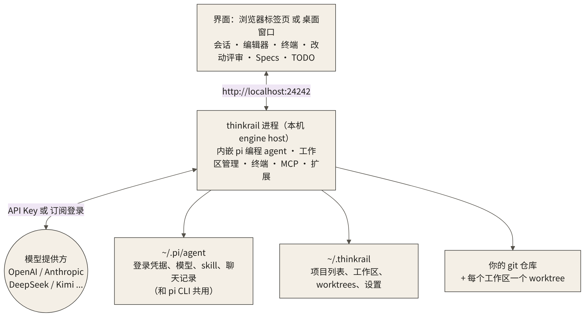
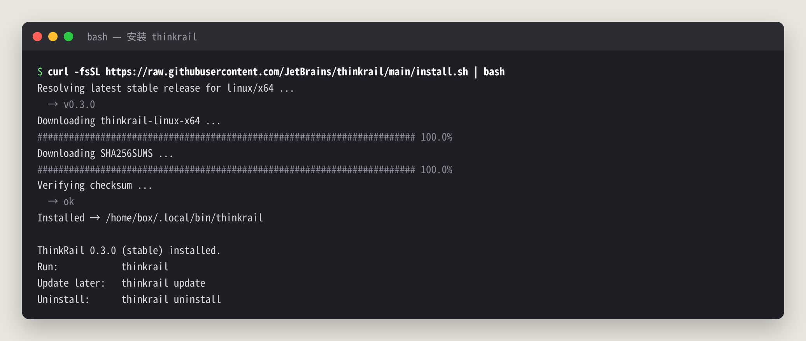
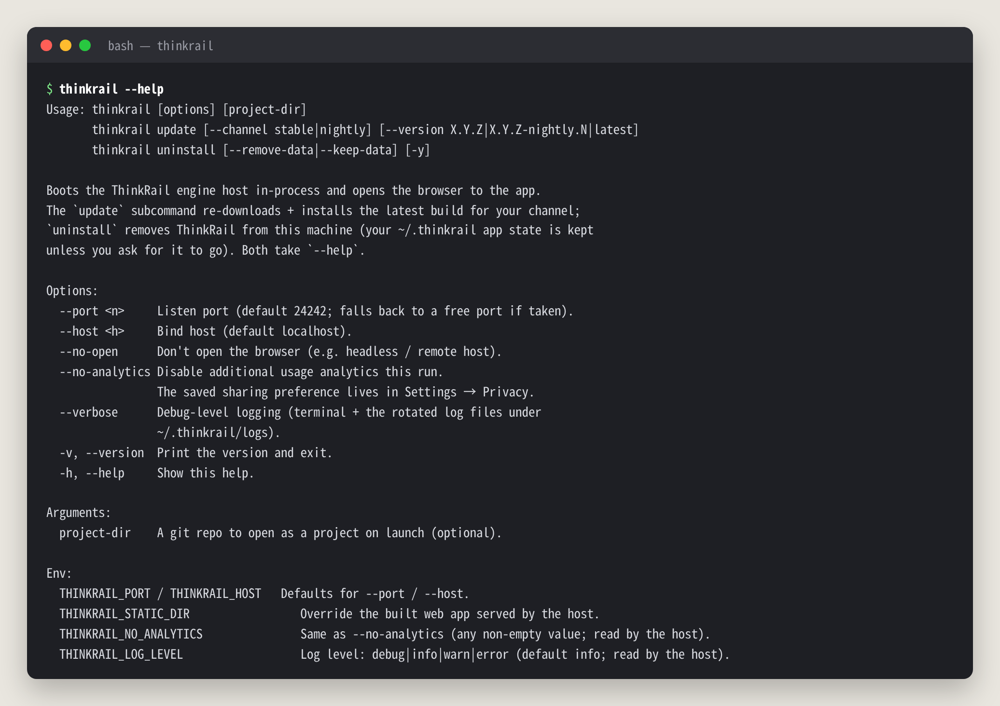
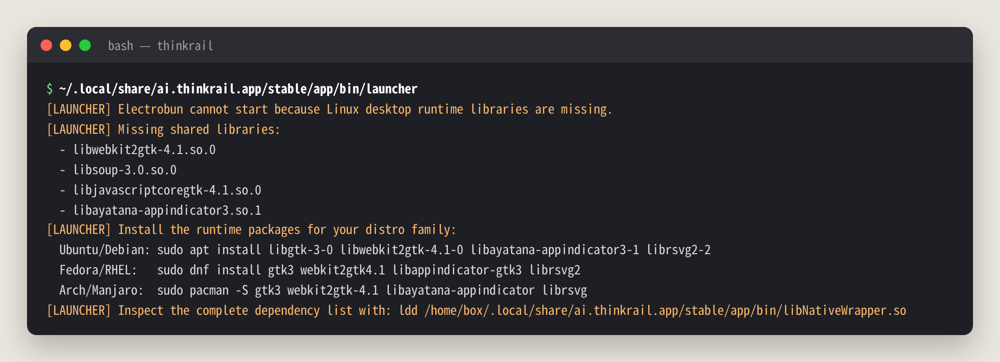
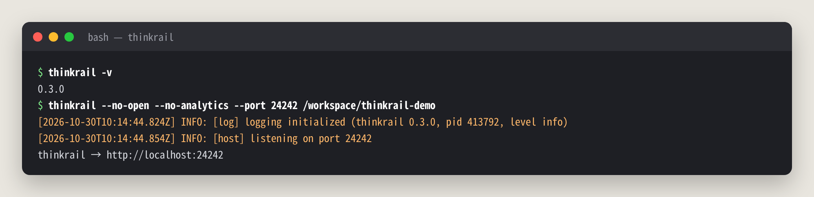
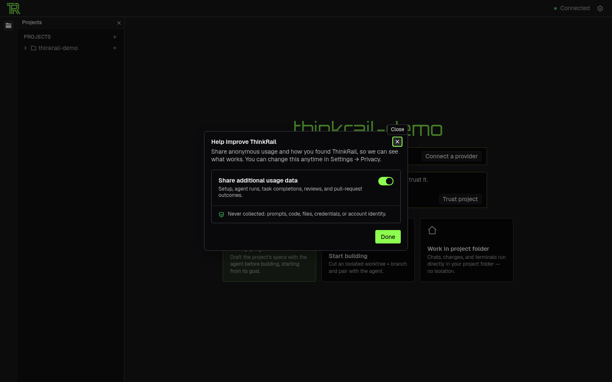
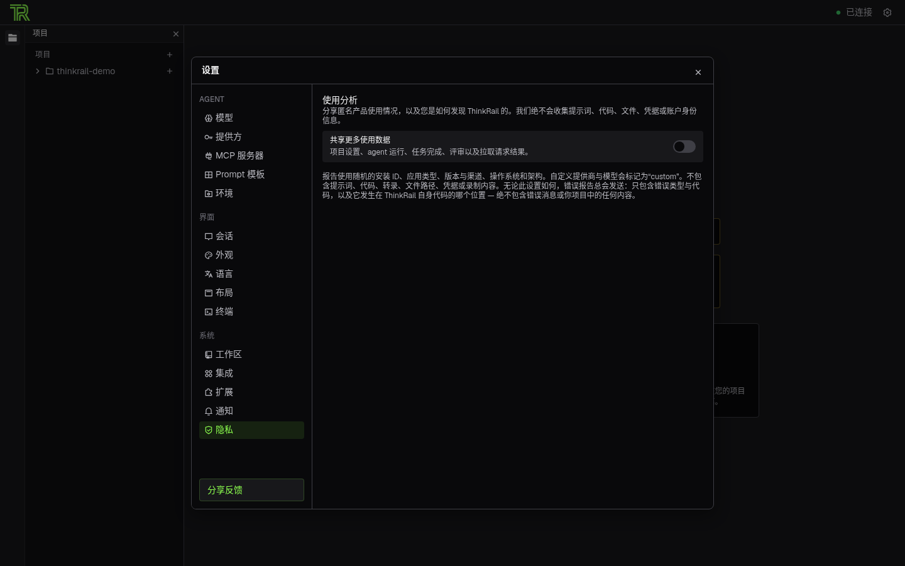
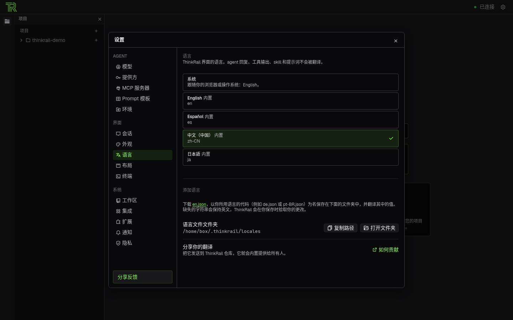
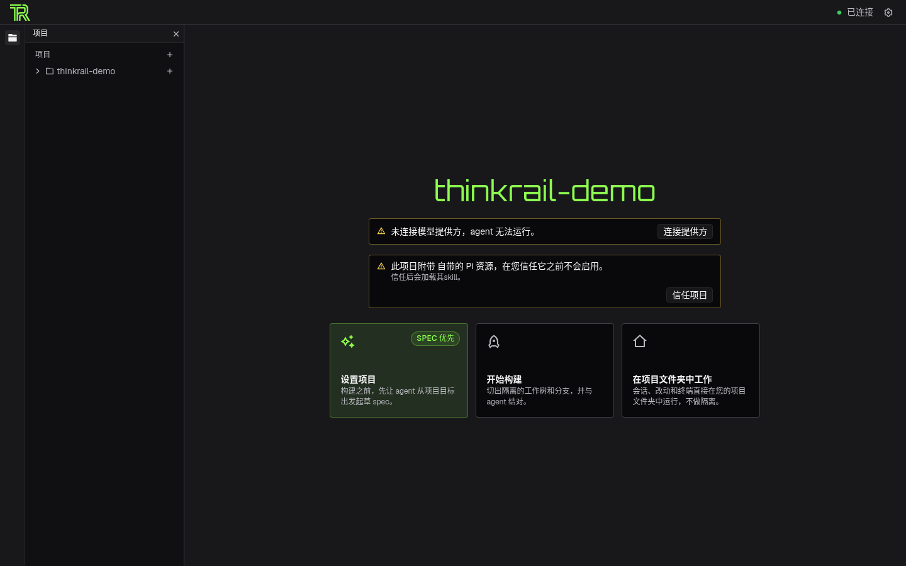

# thinkrail 中文教程：JetBrains 开源的 agent 原生 IDE，隔离工作区 + 改动评审 + Spec 图

> **非官方中文教程**。原项目 [JetBrains/thinkrail](https://github.com/JetBrains/thinkrail)（Apache-2.0），本仓库与 JetBrains 无关。

📚 免费版只讲“是什么、怎么装、首次启动怎么设置”。完整版（模型接入、工作区实战、评审与 Spec 流程、踩坑排错）在知识星球「开源抢先站」：[https://t.zsxq.com/mc4td](https://t.zsxq.com/mc4td)

🎟️ 首发 6 折：新人先领 20 元券，50 元变 30 元（限 50 张，11 月 29 日截止）👉 [领券](https://t.zsxq.com/jk0TT)

> 适用版本：ThinkRail v0.3.0 stable（内嵌 pi 编程 agent）｜实测日期：2026-10-30  
> 文中所有终端输出、截图都来自真机实测，不是 README 的翻译。实测没有接入大模型，需要模型的部分在文中标了「⚠️ 未实测」。

## 目录

- [0. 先说结论：值不值得装？](#0-先说结论值不值得装)
- [1. 它到底是什么？解决什么问题？](#1-它到底是什么解决什么问题)
- [2. 安装](#2-安装)
- [3. 首次启动：改中文、关数据共享](#3-首次启动改中文关数据共享)
- [4. 完整版还讲了什么](#4-完整版还讲了什么)
- [来源与许可](#来源与许可)

---

## 0. 先说结论：值不值得装？

如果你已经在终端里用 Claude Code、Codex、pi 这类编程 agent，大概率遇到过这几件烦心事：

- agent 直接在你的主分支上改，改坏了只能 `git stash` / `git checkout .` 一把梭
- 想让两个 agent 并行干两件事，结果它们在同一个目录里互相踩
- agent 说“搞定了”，你得翻半天聊天记录才知道它到底动了哪些文件
- 新开一个会话，上一次讲好的设计约定全忘了

**ThinkRail 干的事，就是给编程 agent 套一个“真 IDE 外壳”，专门治这几件事。** 它是 JetBrains 开源的，核心是四样东西：

1. **隔离的工作区**：每个任务一键切出一个 `git worktree` + 独立分支，agent 只在里面改，不碰你的主目录。
2. **看得懂的改动评审**：所有改动按文件、按代码块（hunk）列出来，每块都能单独「保留 / 撤销」，像审 PR 一样审 agent。
3. **Spec 图**：项目里的 `SPEC.md` 用 YAML 头互相引用，连成一棵树，agent 先读 spec 再写代码，约定不会随会话丢失。
4. **一整套 IDE 部件**：Monaco 编辑器、文件树（带 git 改动标记）、真终端、TODO 计划、Skill、MCP、扩展。

我的实测结论是：

- **不接模型也能先把“壳”用起来。** 安装一条命令，工作台、终端、文件树、改动评审、Specs 面板、创建 worktree 工作区，我全都在没有任何 API Key 的情况下跑通了。
- **界面自带简体中文**（v0.3.0 刚加的），设置里一键切换，国内提供方 DeepSeek、Kimi、通义（Qwen）、智谱（Z.AI）、MiniMax、小米都在列表里，填 API Key 就能用。
- **它本身不是 agent，是 pi 的图形外壳。** 模型能力、上下文管理都是 pi 的事，ThinkRail 负责隔离、评审和 spec。所以写代码的质量取决于你接的模型，不取决于 ThinkRail。
- **要注意的地方**：版本还在 0.x，桌面版对 Linux 系统库要求高（我在 Debian 13 上没跑起来）；首次启动的“共享更多使用数据”开关默认是开的，介意的话记得关（见下方第 3 节）。



---

## 1. 它到底是什么？解决什么问题？

用一句大白话说：**ThinkRail = pi 编程 agent + 一个专门为“让 agent 干活”设计的 IDE。**

pi 是一个开源的命令行编程 agent（npm 包 `@earendil-works/pi-coding-agent`）。ThinkRail 把 pi 作为库直接嵌进自己的进程，再在外面包了一层网页界面。它跟 Cursor、Windsurf 这类“在编辑器里加 AI”的思路正好反过来：**先有 agent，再给 agent 配 IDE。**

| 问题 | 在终端里用 agent 时的表现 | ThinkRail 的解法 |
|---|---|---|
| **改动没隔离** | agent 直接改你的工作目录，几个任务混在一起 | 每个任务一个工作区 = 一个 `git worktree` + 一个新分支 |
| **改了什么说不清** | 只能翻聊天记录、自己 `git diff` | 「改动」视图：按文件、按 hunk 列出，逐块保留 / 撤销，标记已评审 |
| **约定记不住** | 每个新会话都要重新交代背景 | `SPEC.md` 组成的 spec 图，agent 通过专用的 `spec_*` 工具读写 |
| **多 agent 管不过来** | 开一堆终端窗口，不知道谁在等你 | 左侧项目 / 工作区列表，`Ctrl+K` 只列出正在跑或等你回复的会话 |
| **没有图形界面** | 不熟命令行的人用不了 agent | 编辑器、文件树、终端、diff 全在一个窗口里 |

几个需要先搞清楚的事实：

- **它有两种形态**：桌面 App（macOS / Windows / Linux），和一个 `thinkrail` 命令行程序（启动后在浏览器里打开同一个界面）。两者内嵌同一个 engine host，体验一样。本文实测的是 CLI 版。
- **它没有自己的账号体系。** 模型的登录信息走 pi 自己的认证，存在 `~/.pi/agent` 里。如果你本来就在用 pi CLI，两边共用配置、共用聊天记录，可以来回切换。
- **ThinkRail 自己的状态**（项目列表、工作区、设置、主题、语言包）放在 `~/.thinkrail`。
- **只能打开 git 仓库**作为项目，因为工作区就是 git worktree。

---

## 2. 安装

### 2.1 CLI 版（推荐先用这个）：一条命令

macOS / Linux（Windows 的 Git Bash 也行）：

```bash
curl -fsSL https://raw.githubusercontent.com/JetBrains/thinkrail/main/install.sh | bash
```

Windows（cmd 或 PowerShell）：

```powershell
powershell -c "irm https://raw.githubusercontent.com/JetBrains/thinkrail/main/install.ps1 | iex"
```

脚本会自动识别系统和架构，下载对应的单文件程序，**校验 SHA-256**，然后放进 PATH。这是我实测的输出：



装完是一个 **约 245MB 的单文件**（`~/.local/bin/thinkrail`），不需要你本机装 Node 或 Bun。README 里写的 Node ≥ 22.19 是**从源码开发**时才需要的，我的测试机 Node 是 v20，照样能跑。

如果终端提示找不到 `thinkrail`，重开一个终端，或者手动把 `~/.local/bin` 加进 PATH。

常用的管理命令：

```bash
thinkrail -v                      # 看版本，我这里是 0.3.0
thinkrail update                  # 升级到当前通道的最新版
thinkrail uninstall               # 卸载程序；会问你要不要删 ~/.thinkrail，默认保留
thinkrail uninstall --remove-data # 连数据一起删
```

想装尝鲜版或锁定版本，给脚本传参数：

```bash
curl -fsSL https://raw.githubusercontent.com/JetBrains/thinkrail/main/install.sh | bash -s -- --channel nightly
curl -fsSL https://raw.githubusercontent.com/JetBrains/thinkrail/main/install.sh | bash -s -- --channel stable --version 0.1.2
```

`thinkrail --help` 的完整输出如下，下一节会用到其中几个参数：



### 2.2 桌面版

在 GitHub Releases 页面下载对应的安装包：

| 系统 | 安装包 | 说明 |
|---|---|---|
| macOS 14+（Apple Silicon / Intel） | `thinkrail-desktop-darwin-arm64.dmg` / `-x64.dmg` | 按架构选 DMG；官方说早期或本地构建的 DMG 可能未签名，会被 Gatekeeper 拦 |
| Windows x64 | `thinkrail-desktop-windows-x64.zip` | 解压完整个 ZIP，在原位置运行里面的 setup 程序（已签名） |
| Linux x64 / ARM64 | `thinkrail-desktop-linux-x64.tar.gz` | 解压后运行 `./installer`，未签名 |

桌面版会在后台检查更新，在「设置 → 更新」里点「下载 → 安装并重启」。CLI 版在同一个页面会出现「Run Update」，相当于在后台帮你跑 `thinkrail update`，更新完要手动重启。

**Linux 桌面版的坑我替你踩了。** 安装器本身能跑，会把程序解压到 `~/.local/share/ai.thinkrail.app/` 并创建桌面快捷方式。但一启动就报缺系统库：



官方要求 glibc 2.38+，以及 GTK 3、WebKitGTK 4.1、Ayatana AppIndicator 3、librsvg 2，**也就是 Ubuntu 24.04 或更新的系统**。在 Ubuntu 上执行报错里给的那行命令就行：

```bash
sudo apt install libgtk-3-0 libwebkit2gtk-4.1-0 libayatana-appindicator3-1 librsvg2-2
```

我的测试机是一台没有桌面环境的 Debian 13 服务器，软件源装不上这几个包，所以**桌面版的界面我没有实测** ⚠️。不过官方说桌面版和 CLI 版跑的是同一套代码，所以本文后面的界面操作两边是一样的。

> 我的建议：Linux 用户、远程服务器用户直接用 CLI 版，省事。

---

## 3. 首次启动：改中文、关数据共享

### 3.1 启动

在终端里执行：

```bash
thinkrail                     # 启动并自动打开浏览器
thinkrail ~/code/my-project   # 启动时直接把这个 git 仓库加成项目
```

我是在服务器上测的，用了三个参数：`--no-open` 不自动开浏览器，`--no-analytics` 本次运行不额外共享使用数据，`--port` 指定端口（默认就是 24242，被占用时会自动往上找空闲端口）：



看到 `thinkrail → http://localhost:24242` 这一行，就用浏览器打开这个地址。

**关掉终端 = 关掉 ThinkRail。** 它就是这个进程本身，想常驻可以放进 tmux 或 screen 里。

### 3.2 首次弹窗：“共享更多使用数据”默认是开的

第一次打开会弹一个「Help improve ThinkRail」的窗口：



这里有个细节：**我明明加了 `--no-analytics`，弹窗里的开关还是默认开着的。** 按 README 的说法，`--no-analytics` 只管“这一次运行”，这个开关管的是“保存下来的偏好”，两者是分开的。介意的话直接把开关关掉，再点 Done。

关于隐私，官方 README 写得很清楚：

- **基础使用事件**（启动、新建会话、发消息、连接提供方）总是会发，绑定一个随机的安装 ID，**不含**提示词、代码、文件、凭据和账号身份。
- **错误报告总是会发**，只含错误类型、错误码和出错位置（ThinkRail 自己的代码），不含错误信息、文件路径和项目内容。
- 「共享更多使用数据」只有开着时才会额外发送更多产品使用数据和来源渠道。

之后随时可以在「设置 → 隐私」里改。我关掉之后是这样的：



### 3.3 把界面改成中文

我用的浏览器语言是英文，所以界面一开始是英文。点右上角的齿轮进「Settings → Language」，选「中文（中国）」，**立刻生效，不用重启**：



几点说明：

- 内置语言有英文、西班牙语、简体中文、日语四种，选「系统」就跟随浏览器或系统语言。
- **只翻译界面。** agent 的回复、工具输出、skill 和提示词都不会被翻译。想让 agent 说中文，就用中文跟它说话，或者在项目的 `AGENTS.md` 里写一句“请始终用简体中文回复”。
- 翻译偶尔有没翻完的英文（比如 API Key 弹窗里的“Enter DeepSeek API key”），属于正常现象。想加别的语言，下载 `en.json` 翻译好，按语言代码改名（比如 `de.json`）放进 `~/.thinkrail/locales`，保存即生效；没翻的字段会保持英文。

### 3.4 首页长什么样

改完中文，回到首页：



首页有两条黄色提示和三张卡片：

- **「未连接模型提供方，agent 无法运行」**：怎么连模型（含国内提供方和 ChatGPT 订阅登录）在完整版第 4 节。
- **「此项目附带自带的 Pi 资源，在您信任它之前不会启用」**：项目仓库里如果有 `.pi/` 目录（项目级的 pi 设置、扩展、skill、提示词、`SYSTEM.md`、MCP 配置），ThinkRail 默认**不加载**，要你点「信任项目」之后才加载。这是防止你打开一个陌生仓库时，里面的扩展偷偷执行。**陌生仓库别急着点信任。**
- 三张卡片是三种开工方式：
  - **设置项目（SPEC 优先）**：先让 agent 从项目目标出发起草 spec，再开始写代码。
  - **开始构建**：切出一个隔离的 worktree 和分支，跟 agent 结对。
  - **在项目文件夹中工作**：会话、改动和终端直接在你的项目目录里跑，不隔离。

---

## 4. 完整版还讲了什么

下面这些章节在知识星球的完整版里：

| 章节 | 一句话简介 |
|---|---|
| 连接模型 | 订阅登录和 API Key 两种方式，国内可用的 8 家提供方对照表，ChatGPT 订阅登录和远程服务器登录卡住的解法，选默认模型和评审模型 |
| 工作台导览 | 项目列表、编辑器、真终端、文件树和 git 改动标记，不接模型也能用的部分 |
| 工作区与 worktree | 创建隔离工作区的实测全过程、worktree 存在哪、“已停留”自动收纳规则、推分支开 PR 的流程 |
| 评审改动 | 按代码块保留 / 撤销、已评审进度和 `J` 快捷键，以及每轮回执和 Review turn 的机制 |
| Specs | spec 图的结构和 YAML 头字段、Specs 面板实测，可直接复制的中文版 `AGENTS.md` 片段 |
| Skill、MCP 和扩展 | 13 个内置 skill 各管什么，5 个 MCP 预设和授权规则，Visualize / 选择题 / 联网三个扩展 |
| 常见坑和解法 | 12 个实测踩到的坑：桌面版缺库、数据共享开关、Codex 登录不通用、服务器上 OAuth 卡住、项目信任等 |
| 进阶玩法 | SSH 端口转发远程用、和 pi CLI 来回切换、子 agent 并发、自定义主题和语言、日志排错 |
| 没实测的部分 | 哪些内容来自官方文档、为什么没测，一张表说清楚 |

---

## 加入知识星球「开源抢先站」看完整版

完整模型接入、工作区实战、评审与 Spec 流程、踩坑排错：[https://t.zsxq.com/mc4td](https://t.zsxq.com/mc4td)


🎟️ 首发 6 折新人券（20 元，限 50 张，2026-11-29 截止）：[https://t.zsxq.com/jk0TT](https://t.zsxq.com/jk0TT)，先领券再加入更划算。

---

## 来源与许可

- 原项目：<https://github.com/JetBrains/thinkrail>，官网：<https://thinkrail.ai/>
- 原项目采用 **Apache License 2.0** 许可，Copyright 2026 JetBrains s.r.o.。本仓库是独立撰写的非官方使用教程，不是官方文档，与 JetBrains 没有隶属或背书关系；文中引用的界面文字、命令名、skill 名和少量英文终端输出属于原项目，版权归原作者所有。
- ThinkRail 内嵌的编程 agent 是 pi（npm 包 `@earendil-works/pi-coding-agent`），有它自己的许可。
- 文中演示用的“番茄钟”项目是我为演示随手写的。
- 本教程的文字与图片采用 [CC BY-NC-SA 4.0](LICENSE.md) 许可。
